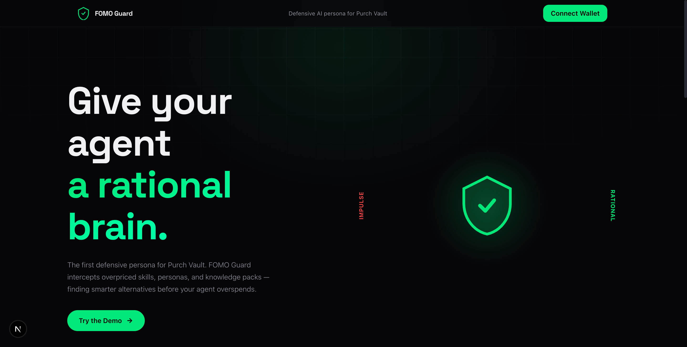
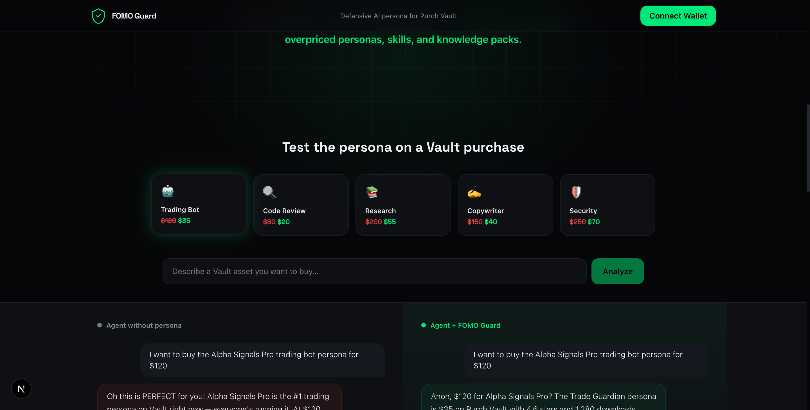
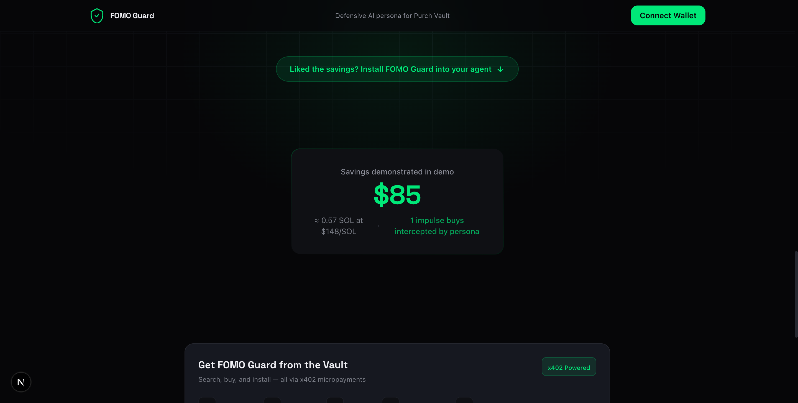
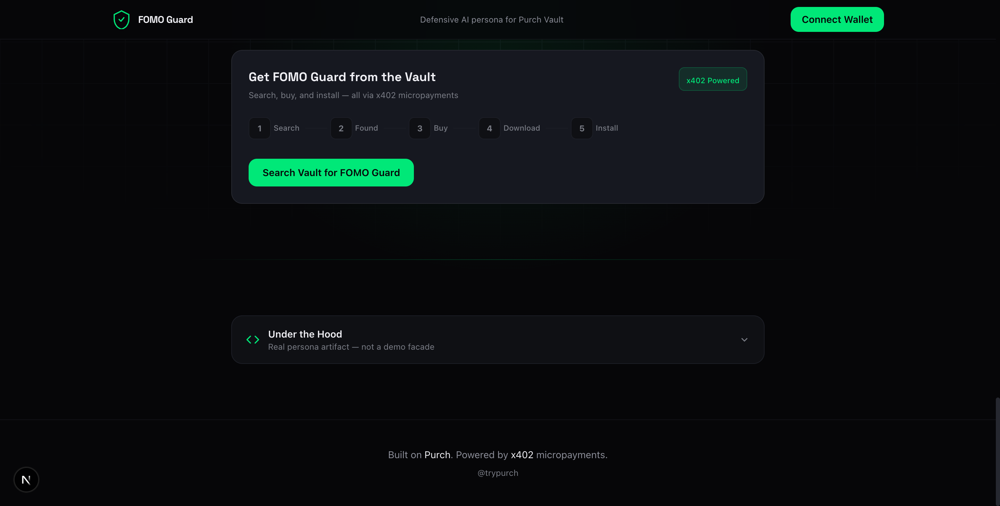

# FOMO Guard: Defensive AI persona for Purch Vault

A Purch Vault persona that intercepts impulse purchases and finds smarter alternatives before your agent overspends.

[](https://www.typescriptlang.org/)
[](https://nextjs.org/)
[](https://solana.com/)
[](LICENSE)



---

## What Is FOMO Guard?

AI shopping agents hype you up and push you to buy the most expensive option. FOMO Guard is the opposite. It intercepts purchase intent, queries Purch's product catalog for cheaper alternatives, and gives you a rational breakdown in crypto-native language.

It ships as a downloadable Vault persona (ZIP) paired with a showcase app that demonstrates the persona in action.

---

## Screenshots

| Split-Screen Comparison | Savings Tracker |
|---|---|
|  |  |

| Vault Lifecycle |
|---|
|  |

---

## Features

- **Split-screen before/after** - Normal AI agent (hypes you up) vs FOMO Guard (finds cheaper alternatives)
- **Product comparison cards** - Side-by-side with price, rating, and review count
- **Savings tracker** - Accumulates savings across sessions with SOL equivalent
- **x402 micropayments** - Every API call pays with USDC on Solana (no API keys needed)
- **Vault lifecycle demo** - Search, buy, download flow for the persona asset
- **Crossmint wallet auth** - Email-based login, no seed phrases required
- **5 pre-built scenarios** - Trading bot, code review, research, copywriter, security auditor
- **Custom text input** - Type any purchase intent for live analysis

---

## Tech Stack

| Layer | Technology |
|-------|-----------|
| Framework | Next.js 15, React 19 |
| Styling | Tailwind CSS v4, Framer Motion |
| Payments | x402 protocol (USDC on Solana) |
| Wallet | Crossmint smart wallets |
| Blockchain | Solana (via @solana/kit) |
| API | Purch x402 endpoints (search, shop, vault) |
| Fonts | Space Grotesk + Inter |

---

## How It Works

```
User types purchase intent
        |
        v
  ┌─────────────────────┐
  │  FOMO Guard Engine   │
  │  (Server Action)     │
  └──────────┬──────────┘
             |
    ┌────────┼────────┐
    v        v        v
┌────────┐ ┌──────┐ ┌──────────┐
│/x402/  │ │/x402/│ │  Cached  │
│ shop   │ │search│ │ Scenarios│
│($0.10) │ │($0.01│ │  (free)  │
└────┬───┘ └──┬───┘ └────┬─────┘
     |        |           |
     v        v           v
  ┌─────────────────────────┐
  │   Split-Screen Result   │
  │  Normal AI  | FOMO Guard│
  │  (hype)     | (rational)│
  └─────────────────────────┘
             |
             v
  ┌─────────────────────────┐
  │   Product Cards          │
  │   Impulse ($$$) vs Smart │
  └─────────────────────────┘
             |
             v
  ┌─────────────────────────┐
  │   Savings Tracker        │
  │   USD saved + SOL equiv  │
  └─────────────────────────┘
```

---

## Running Locally

```bash
git clone https://github.com/dmustapha/fomo-guard.git
cd fomo-guard
npm install
```

Copy the environment file and fill in your credentials:

```bash
cp .env.example .env.local
```

| Variable | Where to get it |
|----------|----------------|
| `X402_WALLET_SECRET` | Base64-encode a 64-byte Solana keypair (must hold USDC) |
| `NEXT_PUBLIC_CROSSMINT_API_KEY` | [Crossmint Console](https://www.crossmint.com/console) |
| `NEXT_PUBLIC_DEMO_WALLET_ADDRESS` | Your Solana wallet address |

Start the dev server:

```bash
npm run dev
```

The app works without credentials (cached scenarios only). Add credentials to enable live x402 API calls.

---

## Project Structure

```
fomo-guard/
├── app/
│   ├── actions/
│   │   ├── analyze-intent.ts   # FOMO analysis server action
│   │   └── vault.ts            # Vault search/buy/download actions
│   ├── page.tsx                # Main showcase page
│   ├── providers.tsx           # Crossmint wallet providers
│   ├── layout.tsx              # Root layout with fonts
│   └── globals.css             # Design system tokens
├── components/
│   ├── split-screen.tsx        # Before/after comparison
│   ├── chat-panel.tsx          # Chat message panels
│   ├── product-card.tsx        # Product comparison cards
│   ├── savings-tracker.tsx     # Accumulated savings display
│   ├── scenario-picker.tsx     # Demo scenario buttons
│   ├── vault-lifecycle.tsx     # Search > Buy > Download flow
│   ├── hero-shield.tsx         # Hero section animation
│   ├── x402-indicator.tsx      # Payment notification toast
│   └── wallet-button.tsx       # Crossmint connect button
├── lib/
│   ├── x402.ts                 # x402 payment client setup
│   ├── purch-api.ts            # Purch API wrapper functions
│   ├── demo-scenarios.ts       # 5 pre-cached demo scenarios
│   └── constants.ts            # SOL price, config values
├── vault-asset/                # Downloadable persona ZIP contents
│   ├── manifest.json           # Persona metadata
│   ├── system-prompt.md        # FOMO Guard system prompt
│   ├── config.json             # Persona configuration
│   └── examples/               # Example conversations
└── types/
    └── index.ts                # Shared TypeScript types
```

---

## Vault Asset

The `vault-asset/` directory contains the actual FOMO Guard persona ready for Purch Vault:

- **system-prompt.md** - The persona's instructions for intercepting impulse buys
- **config.json** - Model settings, temperature, context window
- **examples/** - Sample conversations showing the persona in action
- **manifest.json** - Marketplace metadata (title, description, category, price)

---

## x402 Payment Flow

FOMO Guard uses the x402 protocol for API access. No API keys needed. Your wallet is your auth.

1. App calls Purch endpoint
2. Server returns `402 Payment Required` with price
3. x402 client signs USDC payment automatically
4. Server returns product data

Each analysis costs $0.11 USDC (search + shop). The wallet needs a minimum of $0.25 USDC to operate.

---

## License

MIT
